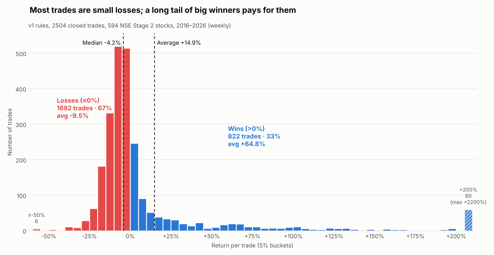

# Weinstein Stage Analysis: TradingView indicator + NSE backtest

A TradingView Pine Script indicator based on Stan Weinstein's Stage Analysis, plus a Python backtest of the same rules on 594 NSE stocks over 10 years of weekly data.

| Folder | What's inside |
|---|---|
| `pine/` | `weinstein-stage-analysis-v1.pine`: the TradingView indicator (Pine v6) |
| `backtest/` | `stage_backtest.py`: Python port of the indicator's rules, used for the backtest |
| `data/` | `Stage_S2_Analysis_2026-10-01.xlsx` (the stock list) and `price_cache.pkl` (weekly price snapshot used for the results) |
| `results/` | `backtest_trades.csv` (one row per trade) and `backtest_by_stock.csv` |
| `charts/` | `trade_return_histogram.png` and the code that draws it, `make_histogram.py` |
| `tools/` | `run_offline.sh`: re-runs the backtest on the saved price snapshot, with no internet needed |

---

## 1. The indicator (`pine/weinstein-stage-analysis-v1.pine`)

Use it on a **weekly** chart. On a daily chart, the week lengths are converted automatically (×5).

- **Stages:** background colour plus "S# start" and "S# end" labels for Stage 1 (Base), 2 (Advancing), 3 (Topping) and 4 (Declining). The stage is judged from the 30-week MA's slope and price's position relative to it. Each stage can only move to the stages that are allowed to follow it.
- **ENTER:** either (a) within 4 weeks of Stage 2 starting, a close above the top of the base on 2× average volume, or (b) a light-volume retest that holds within 3% of the breakout level.
- **ADD:** at most 3 tranches in total, at least 3 weeks apart, only while the trade is in profit and above the 10-week MA. It triggers on a bounce off the 10-week MA, or on a new high with 2× volume.
- **HOLD:** in a position with no ENTER, ADD or EXIT signal on that bar.
- **EXIT:** Investor mode (the default) exits on a close below the 30-week MA, or on Stage 4. Trader mode also exits on a heavy-volume close below the 10-week MA.

To use it in TradingView: open the Pine Editor, paste the file, click **Add to chart**.

## 2. Running the backtest

```bash
python3 -m pip install --user -r requirements.txt

# Fresh data from Yahoo Finance (NSE, .NS tickers):
python3 backtest/stage_backtest.py data/Stage_S2_Analysis_2026-10-01.xlsx --years 10

# Or reproduce the exact results below from the saved snapshot (no internet):
sh tools/run_offline.sh

# Redraw the histogram:
python3 charts/make_histogram.py
```

> `data/price_cache.pkl` is a pandas pickle. Only load pickle files from sources you trust. This one was generated by the backtest script itself.

## 3. Results

Every tranche is the same amount of money. A trade runs from ENTER to EXIT. Trades still open at the end are counted in "All trades" at their last weekly close.

**Step 1: return of one trade**

> Return % = (Σ exit price ÷ buy price of each tranche − number of tranches) ÷ number of tranches × 100

*Example:* buys at ₹100, ₹110 and ₹121, then an exit at ₹150.
150/100 + 150/110 + 150/121 = 1.50 + 1.36 + 1.24 = 4.10. You put in 3 units, so the return is (4.10 − 3) ÷ 3 = **+36.8%**.

**Step 2: classify.** A **win** is a return above 0%. A **loss** is a return of 0% or below, so breakeven counts as a loss.

**Step 3: the formulas, with the actual numbers**

| Metric | Formula | All trades | Closed trades |
|---|---|---|---|
| Win rate | wins ÷ trades | 1022 ÷ 2835 = **36.0%** | 822 ÷ 2504 = **32.8%** |
| Profit factor | sum of win % ÷ sum of loss % (ignoring the minus sign) | 61,678 ÷ 16,810 = **3.67** | 53,284 ÷ 15,984 = **3.33** |
| Avg win | sum of win % ÷ number of wins | 61,678 ÷ 1022 = 60.35% | 53,284 ÷ 822 = **64.82%** |
| Avg loss | sum of loss % ÷ number of losses | −16,810 ÷ 1813 = −9.27% | −15,984 ÷ 1682 = **−9.50%** |
| Avg holding | total weeks ÷ trades (weeks from first buy to exit) | 53,555 ÷ 2835 = 18.9 wk | 48,107 ÷ 2504 = **19.2 wk** |
| Avg tranches | total tranches ÷ trades | 5562 ÷ 2835 = 1.96 | 4828 ÷ 2504 = **1.93** |

**Self-check:** average return ≈ win rate × avg win + loss rate × avg loss.
For closed trades: 0.328 × 64.82 + 0.672 × (−9.50) = 21.3 − 6.4 ≈ **+14.9%**, which matches the measured average.

Note: profit factor here adds up *percentages*, not rupees. It's a fair comparison only because every tranche is the same size.

## 4. Distribution of trade returns



**How to read the histogram**

- **The big red pile between -15% and 0%** is the 30-week MA exit cutting failed breakouts early. These are the "cost of doing business" trades. Most trades land here, so the median trade is -4.2%.
- **The long blue tail to the right** is where the money comes from. 60 trades returned more than +200%, the best being +2200%. Those few pull the average up to +14.9%, even though a typical trade loses a little.
- **Big losses are rare.** Only 6 trades lost more than 50%, and some of those are probably price-data errors around splits or demergers.
- **What it means in practice:** take every signal. You can't know in advance which breakout becomes a tail winner, and skipping a few could mean missing the trade that pays for a year of small losses.

## 5. Caveats

- **Selection bias.** The stock list is stocks that were in Stage 2 on 2026-10-01, so it's mostly today's winners. The results are optimistic.
- **No costs.** Brokerage, taxes and slippage are not included.
- **Per-trade numbers, not portfolio returns.** Trades overlap in time, and with limited capital you can't take all of them.
- **Data quality.** Yahoo Finance doesn't always adjust correctly for splits, bonuses and demergers.

*This is for learning and research, not investment advice.*
